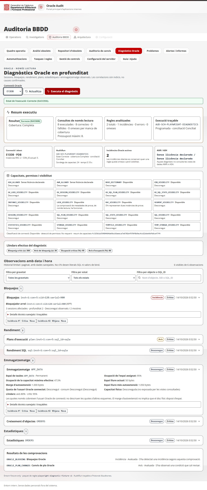

# RFC-E13DB-013-UX-001 — Implementació i validació

**Estat:** implementació de la interfície validada amb proves automatitzades i dades de prova; pendent la validació contra Oracle real. No es declara la RFC completada fins a disposar d’aquesta validació.

## Canvis

- Interfície de Diagnòstics Oracle catalanitzada; s’hi mantenen els identificadors tècnics Oracle, els `SQL_ID`, `SID`, `SERIAL#`, `ORA-*` i els identificadors de regla per assegurar la traçabilitat.
- Selector de connexió, botons, etiquetes d’estat i focus adaptats al tema de l’aplicació. El navegador ha mesurat contrastos WCAG AA per text, opció seleccionada, control desactivat i botó; el focus visible és de 3 px.
- Execució manual i actualització separades. Una referència síncrona impedeix execucions dobles; la petició es limita a cinc minuts i sempre allibera l’estat d’execució.
- Resum executiu amb estats `SUCCESS`, `PARTIAL`, `ERROR`, `SKIPPED` i `UNKNOWN`; un error o cobertura degradada impedeix mostrar un resultat satisfactori complet.
- Comptadors de consultes executades, correctes, fallides i comprovacions omeses, juntament amb el pressupost i l’abast de les regles. Els errors tècnics exposats són els codis sanejats retornats pel backend.
- Observacions agrupades per sessions, bloquejos, rendiment, emmagatzematge i estadístiques; filtres per gravetat, estat i objecte; càrrega progressiva de 50 elements; detalls expandibles i enllaços a incidències.
- Historial amb `limit`, `offset` i recompte total. Els contractes de dades existents es mantenen; els camps de resum afegits són additius i les traduccions es fan a la capa d’interfície.
- La capacitat permanent/UNDO diferencia ocupació de l’espai assignat, percentatge de capacitat màxima efectiva, espai lliure, marge d’autoextensió i quota de l’usuari Oracle connectat. La capacitat física i les quotes d’altres esquemes es mostren com a desconegudes si no són observables.
- La capacitat temporal deriva l’espai assignat dels fitxers temporals i el consum dels segments temporals observats. Les dades insuficients produeixen estat desconegut i cobertura degradada; les regles omeses conserven les incidències existents. `ORACLE_CAPACITY` manté el criteri històric d’espai assignat; `ORACLE_CAPACITY_MAX` és una regla separada per al marge màxim efectiu, i no elimina automàticament les incidències anteriors.

## Validació executada

| Àrea | Verificació | Resultat |
|---|---|---|
| Backend Oracle | `pytest tests/test_oracle_diagnostics.py -q` | 18 proves aprovades. Inclou lectures limitades, capacitat, capacitat desconeguda, preservació d’incidències, paginació, errors i conciliació durable. |
| Frontend Oracle | `npm test -- --run src/views/OracleDiagnosticsView.test.jsx` | 7 proves aprovades. Inclou execució única, temps d’espera, actualització sense execució, errors, traducció, filtres i fals èxit amb consultes fallides. |
| Backend complet | `.venv\Scripts\python.exe -m pytest -q` | 370 proves i 6 subtests aprovats (325,56 s), després dels darrers canvis de cobertura, estat històric i persistència. |
| Frontend complet | `npm test` | 101 proves aprovades en 30 fitxers. |
| Lint frontend | `npm run lint` | Aprovat. |
| Build | `npm run build` | Aprovat; Vite encara avisa que alguns fragments superen 500 kB. |
| E2E backend/navegador | `npm run smoke:ui:real` | Aprovat sobre l’aplicació i API reals, amb dades Oracle simulades en SQLite. Verifica navegació, evidència, càlculs de capacitat persistits, actualització sense POST d’execució i captura de contrast. No és una connexió a Oracle. |
| Seguretat SQL | Proves del runner | Les consultes de prova són `SELECT`; es comprova que no s’executin vistes AWR/ASH ni sentències d’escriptura. |

El navegador va mesurar aquests contrastos al control de connexió i execució: normal **14,68:1**, seleccionat **8,42:1**, desactivat **5,66:1**, botó **8,42:1** i focus **14,68:1** (gruix del contorn: 3 px). Llindars d’acceptació: 4,5:1 per al text i 3:1 per al contorn de focus.

## Evidència visual

Captura de la vista amb la sessió, el resum executiu, els filtres, els resultats i els controls sobre les dades de prova:

La captura prové del smoke amb `AUD-SCH-PLAYWRIGHT-DIAGNOSTICS` en SQLite. No representa dades d’un servidor Oracle real.

## Limitacions i comprovacions pendents

- No s’ha proporcionat connexió/credencials Oracle de prova. Per tant, resten pendents la sintaxi i semàntica reals de les vistes Oracle (incloent `USER_TS_QUOTAS` i `DBA_TEMP_FREE_SPACE`), l’efecte de permisos reals, les variants Oracle/RAC/CDB i la comparació amb capacitat física del sistema d’emmagatzematge.
- L’execució manual es cobreix a la prova d’interfície amb resposta controlada i a la integració API amb el fixture Oracle determinista; no s’ha executat contra una base Oracle real.
- Les quotes observades corresponen a l’usuari de connexió. No s’infereixen quotes d’altres esquemes ni límits físics a partir de l’espai lliure lògic.
- La interfície tradueix els textos de producte i els estats coneguts; els valors proporcionats per Oracle que són noms tècnics (mòdul, esdeveniment, estat de sessió, objecte o vista) es preserven per a la traçabilitat.
- Les proves completes de backend/frontend i el smoke s’han repetit després dels últims ajustos i han passat. La validació contra Oracle real continua sent necessària abans de considerar la RFC completada.
